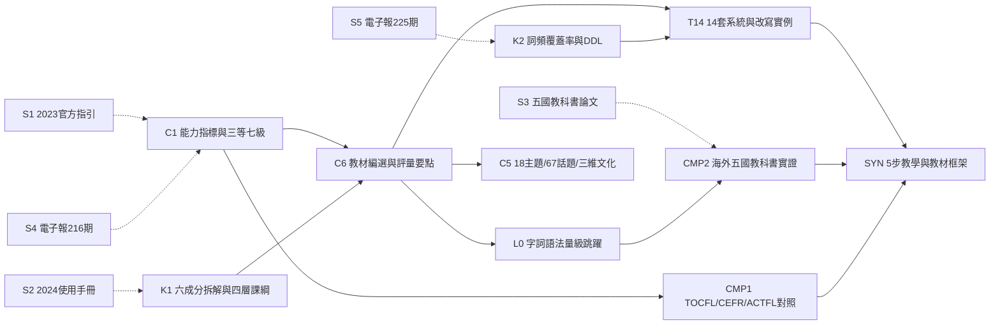

# Node 2 產出：Wiki 知識子圖萃取（Evidence Subgraph — v2 五來源版）

- **萃取範圍**：完整涵蓋 `wiki/` 內 **5 篇已匯入來源**與 **12 個核心知識節點**
- **更新日期**：2026-11-23（由 v1 單一來源擴充為 5 來源多視角子圖）

---

## 1. 概念關係子圖（Subgraph Topology）

---

## 2. 鎖定事實與跨版本核對表（5 篇來源完整溯源）

| 節點 | 引用 Wiki 頁面 | 權威層級 | 鎖定精確事實（零臆測） |
| :---: | --- | :---: | --- |
| `S1/S4` | `[[來源-2023-華語文能力基準應用參考指引]]`、`[[來源-2021-國教院電子報216期-TBCL課程指引]]` | 官方 | 2013 年起教育部華語文八年計畫建置 COCT 與 TBCL；參酌 EBCL、ACTFL、CEFR，召開逾百場專家會議；2023.10 出版臺灣首本官方課程指引 |
| `S2/K1` | `[[能力指標六成分拆解與教案設計]]` | 官方 | 四大身分（教師／學習者／行政／教材編者）用途；課程目標（長期）vs. 學習目標（短期）；能力描述＝**行為＋語言＋話題＋文本**（＋場域／條件）；四層架構：課程大綱→單元大綱→教學大綱→教材（鷹架）；「現有程度＋1 級」設目標 |
| `S5/K2` | `[[詞頻表與數據驅動學習DDL]]` | 官方／混合 | 順暢閱讀須 **95–98%** 詞彙覆蓋率；齊夫定律顯示詞頻高低比死背總量關鍵；TBCL 選詞達 COCT 書面語覆蓋率 **90%** 並轉化為教學詞表；DDL 適合中高級以上，搭配中介語「主題關鍵性（keyword-keyness）」診斷母語負遷移 |
| `L0` | `[[三等七級總覽]]`、`[[詞語表概覽]]`、`[[語法點概覽]]` | 官方 | 漢字 3,100（1–7）、詞語 14,425（2023 指引）／**14,420（2024 手冊微調）**、基礎詞彙 1,254（初期 1,265）、類詞綴 73（僅收代表詞如「書店」）、語法點 496（1–5）；1–4 級切 `*`；實際應用保有 **10% 彈性** |
| `CMP2` | `[[各國華語教科書與TBCL比較分析]]` | 研究 | 何莉玉等（2023.12，《華文世界》132 期）比較美／中／韓／日／泰 5 套教科書：TBCL 涵納美韓中約 **80%**、日泰約 **70%**；扣除不符合收錄原則者，未收錄詞幾乎全在 10% 以內；多數教科書存在單冊跨 3–5 級與相鄰冊重疊問題（僅泰國中位數 1/3/4/5 最分明） |
| `C5` | `[[情境主題與溝通話題]]` | 官方 | 1–5 級 5,288 詞：核心詞 2,512（47.5%）＋ 7 主題 17 次主題（科技僅 32 詞）＋ 67 話題；三等交際文化「哪裡哪裡→你過獎了→承蒙抬愛」＋2024 手冊「撰寫家書」觀念／實踐／產物三維文化 |
| `CMP1` | `[[TBCL與TOCFL-CEFR-ACTFL對照]]` | 官方 | 附錄二（2023.08）四技能刻度不同：TBCL 2 級聽讀低於 CEFR A1，口語已達 A1–A2；寫作圖未列 TBCL 1 級；口語圖未列 Distinguished |
| `T14` | `[[教學實施與評量要點]]`、`[[詞頻表與數據驅動學習DDL]]` | 官方 | 國教院 14 套系統（`coct.naer.edu.tw`）與 5 支教學影片；`edit.jsp` 內建 5 語料庫，實例示範同義詞分級替換：**重視（4 級）← 注重（5 級）→ 講求（6 級）→ 偏重（7 級）** |

---

## Gate 2 自動事實與版本衝突檢核結果
- [x] 全部 5 篇來源皆納入子圖並標明權威層級（官方 vs. 研究 vs. 延伸）
- [x] 跨版本微調數據（2023 版 14,425 詞 vs. 2024 版 14,420 詞；基礎詞彙 1,254 vs. 1,265）顯式標註不隱藏
- [x] 防幻覺紅線維持：絕不臆測《當代中文課程》量化數據（實證數據嚴格引用何莉玉等 2023 的美／中／韓／日／泰五套教科書）
- [x] **Gate 2 判定**：**PASS**
